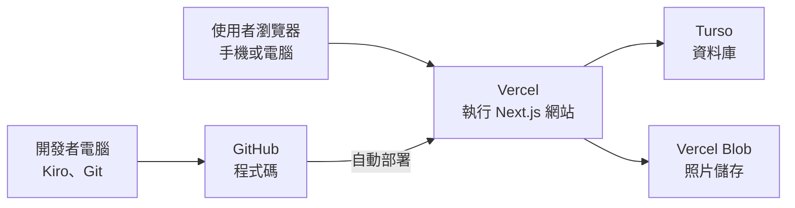
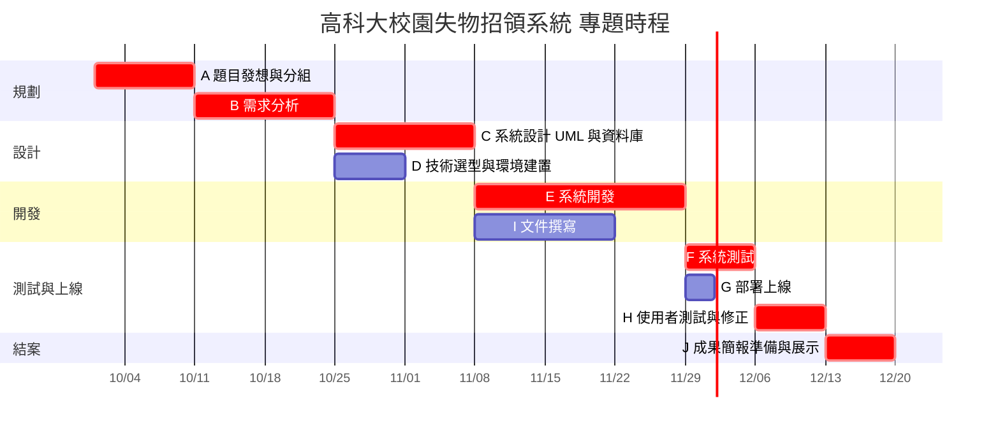
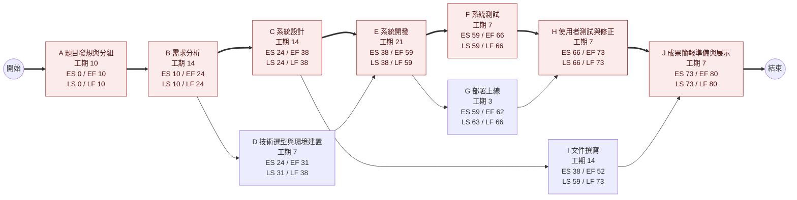

# 高科大校園失物招領系統

> 第 11 組 小組專題｜專題期間：2026/10/1 ～ 2026/12/21
>
> 線上網站：<https://campus-lost-found-topaz.vercel.app>

## 文件導覽

| 文件 | 內容 |
| --- | --- |
| [README.md](README.md)（本頁） | 作業 1：組員、題目與內容＆作業 2：組員任務、甘特圖、PERT/CPM 圖 |
| [hw3.md](hw3.md) | 作業 3：功能性與非功能性需求、使用案例圖、使用案例描述 |
| [hw4.md](hw4.md) | 作業 4：UML 類別圖、循序圖、活動圖 |

---

# 作業 1：組員、專題題目及內容

## 組別與組員

| 角色 | 學號 | 班級 | 姓名 |
| --- | --- | --- | --- |
| 組長 | C113118143 | 資管二甲 | 葉柏慶 |
| 組員 | C113118134 | 資管二甲 | 林浩齊 |
| 組員 | C113118144 | 資管二甲 | 顏品翰 |

## 專題題目

**高科大校園失物招領系統**

## 專題內容

### 動機

校園裡每天都有學生遺失或撿到物品，但目前多半靠社群貼文、公告欄或直接送到學務處，資訊分散：

- 失主不知道東西有沒有被撿到、被送到哪裡。
- 拾獲者不知道該交給誰，常常只能放在原地。
- 學務處需要人工登記、接聽詢問，也難以確認來認領的人是不是真正的失主。

### 目標

建立一個網站，讓學生能**快速登記拾獲物品**、**搜尋遺失物品**並**線上提出認領申請**，由學務處在後台審核，藉此提高失物尋回率、減少管理人員的人工作業。

### 使用者角色

| 角色 | 說明 |
| --- | --- |
| 訪客 | 不需登入，可瀏覽、搜尋與篩選物品 |
| 學生（拾獲者） | 以學校信箱註冊登入，登記拾獲物品（名稱、類別、照片、拾獲地點、拾獲時間、保管位置） |
| 學生（失主） | 搜尋物品並提出認領申請，描述物品特徵作為佐證 |
| 管理員（學務處） | 審核認領申請、確認領取、下架不當或重複的刊登、管理類別與地點 |

### 主要功能

1. **帳號與登入**：只接受學校信箱（`@nkust.edu.tw`）註冊，密碼加密儲存。
2. **登記拾獲物品**：可附最多 3 張照片，上傳時自動壓縮並移除照片中的 GPS 位置資訊，可填寫只有管理員看得到的「隱藏特徵」。
3. **物品列表與搜尋**：依關鍵字、類別、地點、日期、狀態篩選。
4. **認領申請與審核**：失主描述特徵，管理員比對隱藏特徵後核准或駁回；審核通過後失主才看得到保管位置。
5. **物品狀態**：待認領、審核中、已領回、逾期未領（待認領超過 30 天自動標示）。
6. **通知中心**：申請通過、駁回、物品被下架時通知相關的人。
7. **管理員後台**：認領審核、確認領取、下架與復原、類別與地點管理。

### 系統架構與使用技術

| 項目 | 使用的技術 |
| --- | --- |
| 網站框架 | Next.js 16（React 19、TypeScript） |
| 畫面樣式 | Tailwind CSS 4 |
| 資料庫 | SQLite（本機）／Turso（上線），透過 Prisma 7 存取 |
| 照片儲存 | 本機資料夾／Vercel Blob（上線，私人存放） |
| 安全 | bcryptjs（密碼雜湊）、zod（輸入驗證）、httpOnly cookie（登入狀態） |
| 圖片處理 | sharp（轉正、移除 EXIF） |
| 測試 | Vitest（單元測試）、Playwright（端對端測試） |
| 部署 | Vercel（推送到 GitHub 後自動部署） |
| 開發工具 | Kiro（AI 程式開發助手）、Git、GitHub |

---

# 作業 2：組員任務、甘特圖、PERT/CPM 圖

## 個別組員任務

| 組員&nbsp;&nbsp;&nbsp;&nbsp;&nbsp;&nbsp;&nbsp;&nbsp; | 主要負責 | 工作內容 |
| --- | --- | --- |
| 葉柏慶（組長） | 專案管理、系統開發與部署 | 時程規劃與進度追蹤、系統架構與技術選型。以 Kiro 協作開發前後端與資料庫、GitHub 管理、Vercel、Turso、Vercel Blob 部署上線 |
| 林浩齊 | 需求分析、使用者測試 | 訪談使用者並整理需求（作業 3），繪製使用案例圖與撰寫使用案例。拍攝示範物品照片、建立示範資料，邀請同學試用並回報問題 |
| 顏品翰 | 系統設計、文件與簡報 | 繪製 UML 類別圖、循序圖、活動圖（作業 4）、整理系統測試結果。撰寫操作說明，製作期末簡報與展示腳本 |

> 全體組員共同參與：題目討論、需求確認、測試、期末展示。

## 甘特圖

紅色為要徑（Critical Path）上的工作。

## PERT/CPM 圖

每個節點標示工期與最早開始（ES）、最早完成（EF）、最晚開始（LS）、最晚完成（LF），單位為「天」，第 0 天為 10/1。紅色節點與粗線為要徑。

### 要徑分析

| 代號 | ES | EF | LS | LF | 寬裕時間 | 要徑 |
| --- | --- | --- | --- | --- | --- | --- |
| A | 0 | 10 | 0 | 10 | 0 | ✔ |
| B | 10 | 24 | 10 | 24 | 0 | ✔ |
| C | 24 | 38 | 24 | 38 | 0 | ✔ |
| D | 24 | 31 | 31 | 38 | 7 | |
| E | 38 | 59 | 38 | 59 | 0 | ✔ |
| I | 38 | 52 | 59 | 73 | 21 | |
| F | 59 | 66 | 59 | 66 | 0 | ✔ |
| G | 59 | 62 | 63 | 66 | 4 | |
| H | 66 | 73 | 66 | 73 | 0 | ✔ |
| J | 73 | 80 | 73 | 80 | 0 | ✔ |

- **要徑**：A → B → C → E → F → H → J，總工期 **80 天**（10/1 ～ 12/19），在 12/21 截止前完成。
- 要徑上的工作沒有寬裕時間，任何一項延誤都會讓整個專題延期，需優先掌握進度。
- 「技術選型與環境建置」（D）有 7 天、「部署上線」（G）有 4 天、「文件撰寫」（I）有 21 天的寬裕時間，可依組員時間彈性安排。

