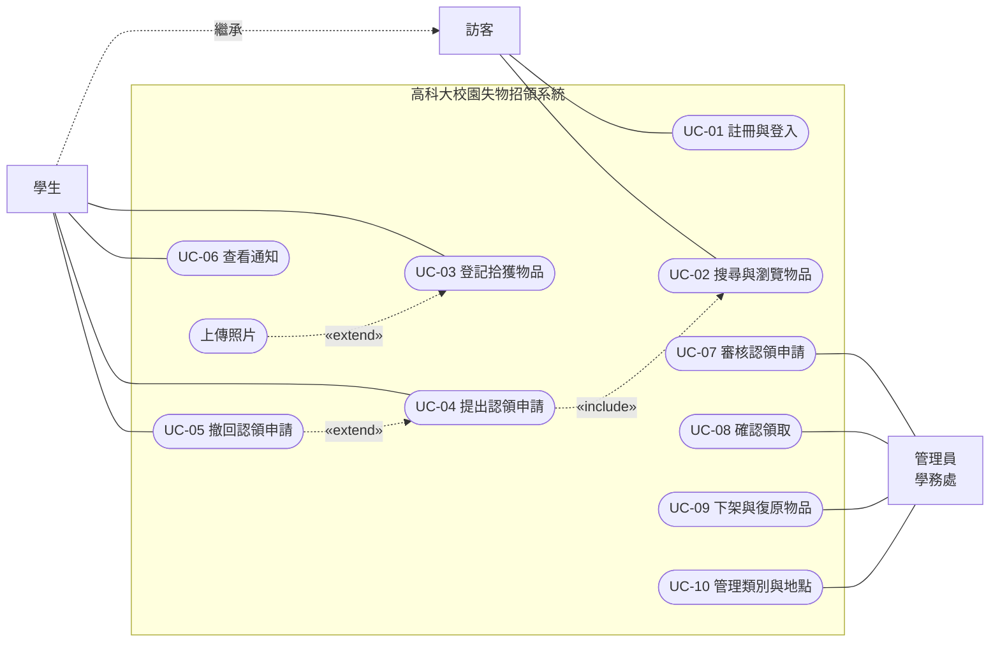

# 作業 3：需求分析與使用案例

> 第 11 組｜高科大校園失物招領系統
>
> 回到 [README](README.md)

## 1. 功能性需求

| 編號 | 需求名稱 | 說明 |
| --- | --- | --- |
| FR-01 | 校園信箱註冊與登入 | 只接受 `@nkust.edu.tw` 信箱註冊，信箱大小寫視為相同，密碼至少 8 碼且註冊只能建立學生帳號，管理員帳號由系統預先建立。 |
| FR-02 | 登記拾獲物品 | 學生登入後可登記拾獲物品，必填物品名稱、類別、拾獲地點、拾獲時間、保管位置；選填描述、詳細地點、照片（最多 3 張）、隱藏特徵，並可選擇是否公開自己的聯絡方式。 |
| FR-03 | 搜尋與篩選物品 | 不需登入即可瀏覽物品列表，並依關鍵字、類別、地點、日期區間、狀態篩選；結果依拾獲時間由新到舊排序，每頁 12 筆。 |
| FR-04 | 提出認領申請 | 失主描述物品特徵（至少 10 個字）作為佐證，提出認領申請；同一件物品可由多人申請，申請人可撤回待審中的申請。 |
| FR-05 | 審核認領申請 | 管理員比對申請人描述與物品的隱藏特徵後核准或駁回（駁回需填原因）；核准一筆後，同物品的其他申請自動駁回。 |
| FR-06 | 確認領取 | 失主到學務處領回物品時，管理員按「確認領取」記錄實際領取時間。 |
| FR-07 | 下架與復原 | 管理員可下架不當或重複的刊登（需填原因），下架的物品一般使用者看不到，可隨時復原。 |
| FR-08 | 物品狀態管理 | 物品狀態分為待認領、審核中、已領回、逾期未領；待認領超過 30 天自動顯示為逾期未領。 |
| FR-09 | 通知中心 | 申請通過、申請被駁回、物品被下架時，系統通知相關使用者，頁首顯示未讀數量。 |
| FR-10 | 類別與地點管理 | 管理員可新增、改名、排序、停用物品類別與地點。 |

## 2. 非功能性需求

| 編號 | 類型 | 說明 |
| --- | --- | --- |
| NFR-01 | 安全性 | 密碼以 bcrypt 雜湊儲存；登入狀態存在簽章過的 httpOnly cookie，所有需要權限的頁面與動作都在伺服器端檢查，學生無法執行管理員動作。 |
| NFR-02 | 隱私保護 | 隱藏特徵只有管理員看得到；保管位置與拾獲者聯絡方式要在申請審核通過後才顯示，上傳的照片自動移除 EXIF（含 GPS 位置）。 |
| NFR-03 | 資料一致性 | 核准、駁回、下架、撤回等狀態變更使用資料庫交易（transaction），同時送出兩次申請或同時核准兩筆申請時，只會有一筆成功。 |
| NFR-04 | 易用性 | 介面為繁體中文且手機與電腦皆可使用，表單送出失敗時保留已填內容，錯誤訊息顯示在對應欄位旁。 |
| NFR-05 | 效能 | 照片在瀏覽器端先縮小至長邊 1600px、每張 1MB 以內再上傳，列表分頁，每頁 12 筆。 |
| NFR-06 | 可維護性與可測試性 | 以 Vitest 撰寫單元測試、Playwright 撰寫端對端測試，共 200 個以上的自動化測試，每次修改後執行完整測試。 |
| NFR-07 | 可用性與部署 | 網站部署於 Vercel，資料庫與照片使用雲端服務（Turso、Vercel Blob），24 小時可存取；程式推送到 GitHub 後自動部署。 |

## 3. 未來規劃功能（非本階段實作）

以下功能已列入規劃，但不在本學期的實作範圍內，作為系統後續擴充的方向。

| 編號 | 功能名稱 | 說明 | 規劃理由 |
| --- | --- | --- | --- |
| FF-01 | 校園信箱驗證 | 註冊後寄送驗證信到學校信箱，點擊連結才能啟用帳號。 | 目前只檢查信箱網域，無法確認註冊者真的擁有該信箱。 |
| FF-02 | 整合學校單一登入（SSO） | 直接使用學校帳號登入，不必另外註冊。 | 減少學生記憶多組密碼，也能確保身分真實。 |
| FF-03 | 失主刊登遺失物與自動比對 | 失主可主動刊登「我遺失了什麼」，系統依類別、地點、時間與關鍵字，自動通知可能相符的拾獲物品。 | 目前只能由失主主動搜尋，若物品晚幾天才被登記，失主可能錯過。 |
| FF-04 | Email／LINE 通知 | 申請通過、駁回等事件同時寄送 Email 或 LINE 訊息。 | 目前只有站內通知，使用者需登入網站才看得到。 |
| FF-05 | 兩層地點選單 | 先選校區、再選建築或教室，篩選校區時一併包含底下的地點。 | 目前地點只有一層，管理員新增的建築與校區沒有上下關係。 |
| FF-06 | 領取 QR Code | 審核通過後產生 QR Code，失主到學務處出示即可快速核對並確認領取。 | 加快現場核對速度，減少人工比對。 |
| FF-07 | 逾期物品處理流程 | 逾期未領的物品可標記為捐贈、轉交警局或銷毀，並保存處理紀錄。 | 目前只標示逾期，沒有後續處理的流程與紀錄。 |
| FF-08 | 管理統計報表 | 統計各校區、各類別的拾獲數量、尋回率、平均領回天數，提供學務處參考。 | 幫助學務處了解遺失熱點，規劃宣導或增設失物招領點。 |
| FF-09 | 帳號安全強化 | 登入失敗次數限制、登出後伺服器端立即讓登入狀態失效。 | 防止暴力破解密碼，以及登入資訊外洩後被冒用。 |
| FF-10 | 多語系介面 | 提供英文介面。 | 方便外籍生與交換學生使用。 |

## 4. 使用案例圖

圖例說明：

- **學生繼承訪客**：學生可以做所有訪客能做的事（搜尋、瀏覽），另外還能登記物品與提出認領。
- **«include»**：提出認領申請前一定要先找到物品（搜尋與瀏覽物品）。
- **«extend»**：「上傳照片」是登記物品時可選的延伸行為，「撤回認領申請」是提出申請後可選的延伸行為（箭頭由延伸的使用案例指向基礎使用案例）。
- 學生的 UC-03 到 UC-06、管理員的 UC-07 到 UC-10 都需要先登入（UC-01）。

## 5. 使用案例描述

### UC-03 登記拾獲物品

| 項目 | 內容 |
| --- | --- |
| 使用案例名稱 | 登記拾獲物品 |
| 參與者 | 學生（拾獲者） |
| 說明 | 學生撿到物品後，在網站上登記物品資訊，讓失主可以搜尋到。 |
| 前置條件 | 學生已登入；已將物品交給保管單位（例如學務處、系辦）。 |
| 主要流程 | 1. 學生點選「登記拾獲物品」。 2. 系統顯示登記表單，類別與地點的選項由資料庫讀出。 3. 學生填寫物品名稱、類別、拾獲地點、詳細地點、拾獲時間、保管位置、描述。 4. 學生選擇照片（最多 3 張），瀏覽器自動縮小壓縮。 5. 學生填寫隱藏特徵，並選擇是否公開聯絡方式。 6. 學生按下送出。 7. 系統檢查欄位與照片，移除照片的 EXIF 資訊後儲存。 8. 系統建立物品，狀態為「待認領」，並導向「我登記的物品」頁面。 |
| 替代流程 | 7a. 必填欄位未填、拾獲時間晚於現在、照片超過 3 張或格式不符：系統在對應欄位旁顯示錯誤訊息，保留已填內容，回到步驟 3。 2a. 學生未登入：系統導向登入頁，登入後回到登記頁。 |
| 後置條件 | 物品出現在公開列表；隱藏特徵與保管位置不公開。 |

### UC-04 提出認領申請

| 項目 | 內容 |
| --- | --- |
| 使用案例名稱 | 提出認領申請 |
| 參與者 | 學生（失主） |
| 說明 | 失主找到疑似自己遺失的物品後，描述物品特徵提出認領。 |
| 前置條件 | 學生已登入；物品狀態為「待認領」或「審核中」。 |
| 主要流程 | 1. 學生在物品列表搜尋並點進物品詳情頁（include UC-02）。 2. 學生點選「申請認領」。 3. 系統顯示物品的公開資訊與申請表單。 4. 學生填寫物品特徵描述（至少 10 個字），以及遺失的大概時間和地點（選填）。 5. 學生按下送出。 6. 系統重新檢查是否可以申請。 7. 系統建立申請（狀態：待審核）；若物品原本是「待認領」，改為「審核中」。 8. 系統顯示「我的認領申請」頁面。 |
| 替代流程 | 6a. 物品已領回、已逾期或已下架：系統顯示無法申請的原因。 6b. 申請人就是拾獲者：系統顯示「不能認領自己登記的物品」。 6c. 申請人對同一物品已有待審申請，或曾被管理員駁回：系統拒絕並顯示原因。 4a. 描述少於 10 個字：系統顯示錯誤並保留已填內容。 |
| 後置條件 | 管理員可在後台看到這筆申請；申請人在通過審核前看不到保管位置。 |

### UC-07 審核認領申請

| 項目 | 內容 |
| --- | --- |
| 使用案例名稱 | 審核認領申請 |
| 參與者 | 管理員（學務處） |
| 說明 | 管理員比對申請人的描述與物品的隱藏特徵，判斷是否為真正的失主。 |
| 前置條件 | 管理員已登入；有待審核的認領申請。 |
| 主要流程 | 1. 管理員進入「認領審核」頁面。 2. 系統依物品分組列出待審申請，並排顯示申請人描述與物品的隱藏特徵、照片、保管位置。 3. 管理員比對特徵，判斷描述相符。 4. 管理員按下「核准」並確認。 5. 系統將申請改為「已通過」、物品改為「已領回」，同物品其他待審申請自動駁回。 6. 系統通知申請人（申請已通過，可查看領取方式）與拾獲者（物品已由失主認領）。 |
| 替代流程 | 3a. 描述不相符：管理員填寫駁回原因並按「駁回」；系統將申請改為「已駁回」並通知申請人。若該物品已沒有其他待審申請，物品改回「待認領」。 4a. 駁回原因未填：系統拒絕並提示原因必填。 |
| 後置條件 | 核准的申請人可在「我的認領申請」看到保管位置與學務處聯絡方式；物品不再接受新的申請。 |

### UC-09 下架與復原物品

| 項目 | 內容 |
| --- | --- |
| 使用案例名稱 | 下架與復原物品 |
| 參與者 | 管理員（學務處） |
| 說明 | 管理員將不當或重複的刊登下架，必要時再復原。 |
| 前置條件 | 管理員已登入。 |
| 主要流程 | 1. 管理員進入「物品管理」頁面，依關鍵字或狀態找到物品。 2. 管理員按「下架」並填寫下架原因。 3. 系統記錄下架原因、時間與管理員，並將物品標記為已下架。 4. 系統駁回該物品所有待審申請（原因：物品已下架），並通知拾獲者與申請人。 |
| 替代流程 | 2a. 下架原因未填：系統拒絕並提示原因必填。 5a. 管理員之後按「復原」：系統取消下架標記；若有已通過的申請則維持「已領回」，否則回到「待認領」，因下架被駁回的申請人可重新申請。 |
| 後置條件 | 已下架的物品不出現在公開列表，詳情頁與照片一般使用者無法存取。 |
