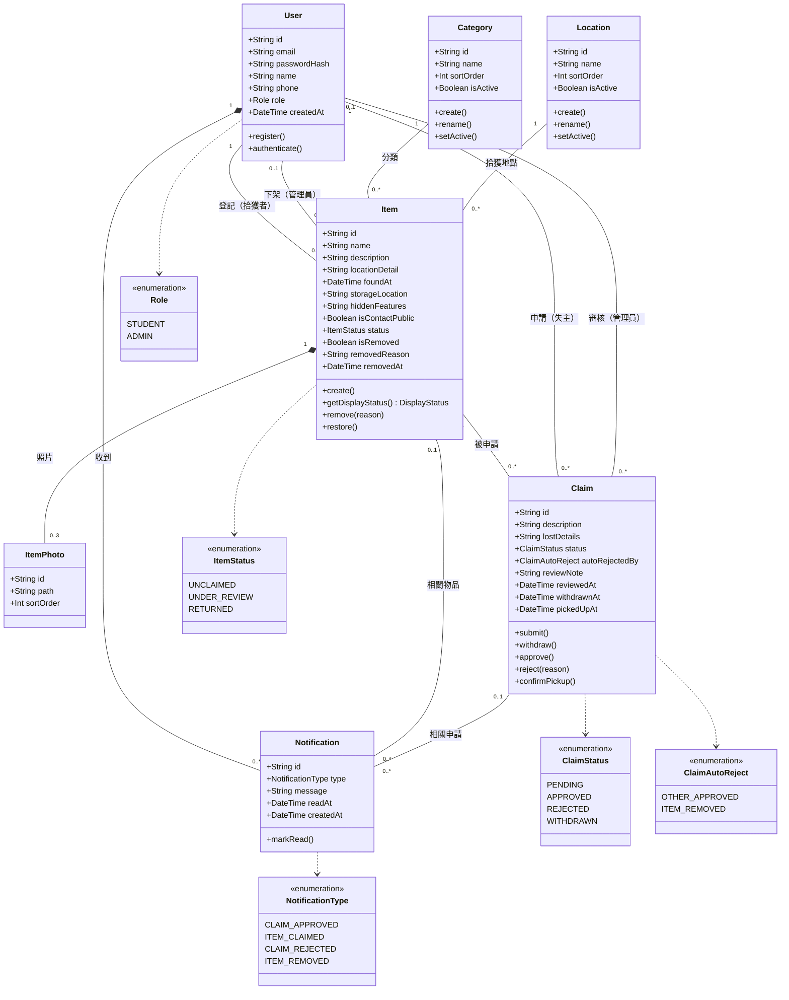
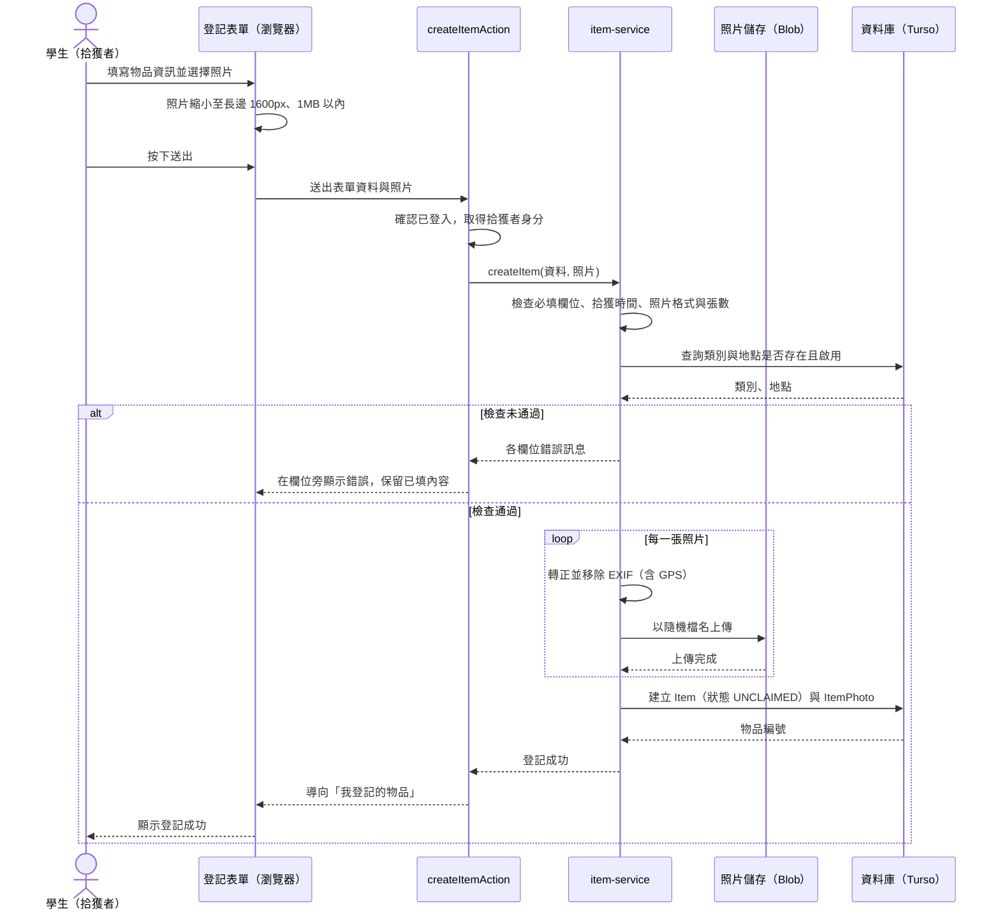
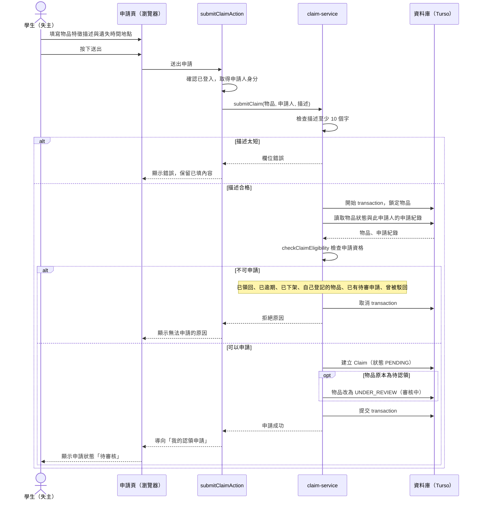
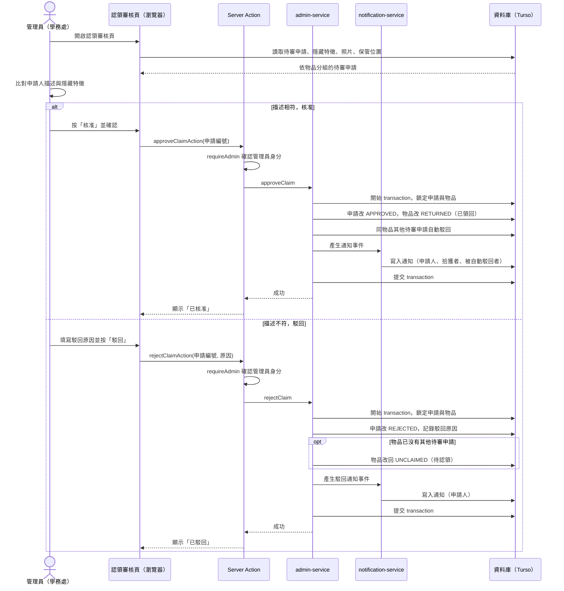
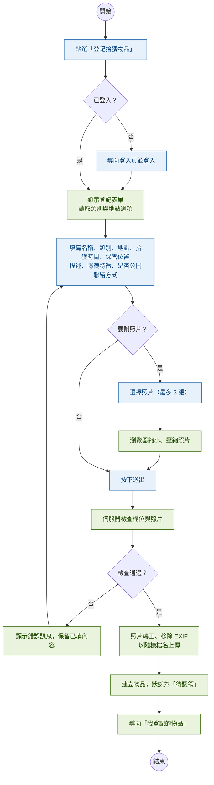
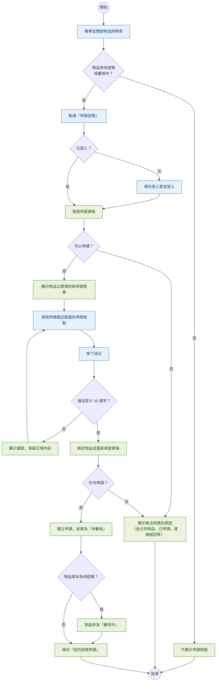
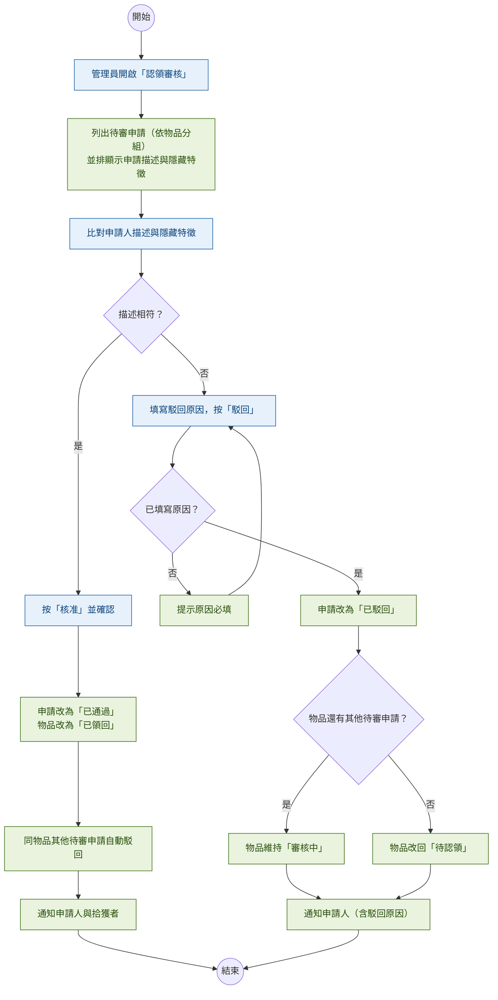

# 作業 4：UML 類別圖、循序圖與活動圖

> 第 11 組｜高科大校園失物招領系統
>
> 回到 [README](README.md)｜使用案例請見 [hw3.md](hw3.md)

本作業的圖表依系統實際的資料模型（`prisma/schema.prisma`）與程式邏輯（`src/lib/`）繪製。循序圖與活動圖針對 hw3 的三個使用案例：

| 使用案例 | 循序圖 | 活動圖 |
| --- | --- | --- |
| UC-03 登記拾獲物品 | [2.1](#21-uc-03-登記拾獲物品) | [3.1](#31-uc-03-登記拾獲物品) |
| UC-04 提出認領申請 | [2.2](#22-uc-04-提出認領申請) | [3.2](#32-uc-04-提出認領申請) |
| UC-07 審核認領申請 | [2.3](#23-uc-07-審核認領申請) | [3.3](#33-uc-07-審核認領申請) |

---

## 1. UML 類別圖

### 類別說明

| 類別 | 說明 | 主要操作實作位置 |
| --- | --- | --- |
| User | 使用者帳號，角色分為學生與管理員；信箱一律存小寫，密碼存 bcrypt 雜湊 | `src/lib/auth-service.ts`（`registerUser`、`authenticateUser`） |
| Item | 拾獲物品。`hiddenFeatures`（隱藏特徵）只有管理員看得到；`storageLocation`（保管位置）審核通過後才給認領人看 | `src/lib/item-service.ts`（`createItem`）、`src/lib/item-status.ts`（`getDisplayStatus`）、`src/lib/admin-service.ts`（`removeItem`、`restoreItem`） |
| ItemPhoto | 物品照片，一件物品最多 3 張；只存路徑，檔案放在 Vercel Blob | `src/lib/storage.ts` |
| Category／Location | 物品類別與拾獲地點，由管理員維護；不提供刪除，以「停用」取代 | `src/lib/taxonomy-service.ts` |
| Claim | 認領申請。一件物品可以有多筆申請；`autoRejectedBy` 記錄系統自動駁回的原因 | `src/lib/claim-service.ts`（`submitClaim`、`withdrawClaim`）、`src/lib/admin-service.ts`（`approveClaim`、`rejectClaim`、`confirmPickup`） |
| Notification | 站內通知；`readAt` 為空表示未讀 | `src/lib/notification-service.ts` |

### 設計重點

- **「逾期未領」不存進資料庫**：資料庫只存三種狀態（`ItemStatus`），`getDisplayStatus()` 在查詢時判斷「待認領且拾獲超過 30 天」顯示為逾期未領，不需要排程程式。
- **「下架」不是狀態**：用 `isRemoved` 等欄位另外記錄，這樣復原時可以回到原本的狀態。
- **組合關係（實心菱形）**：照片屬於物品、通知屬於使用者，主體刪除時一併刪除。

---

## 2. 循序圖

參與者說明：**Server Action** 是 Next.js 在伺服器上執行的表單處理函式；**Service** 是 `src/lib/` 裡的商業邏輯；資料庫為 Turso，照片儲存為 Vercel Blob。

### 2.1 UC-03 登記拾獲物品

### 2.2 UC-04 提出認領申請

### 2.3 UC-07 審核認領申請

---

## 3. 活動圖

圖例：藍色為使用者的動作，綠色為系統的處理，菱形為判斷。

### 3.1 UC-03 登記拾獲物品

### 3.2 UC-04 提出認領申請

### 3.3 UC-07 審核認領申請

